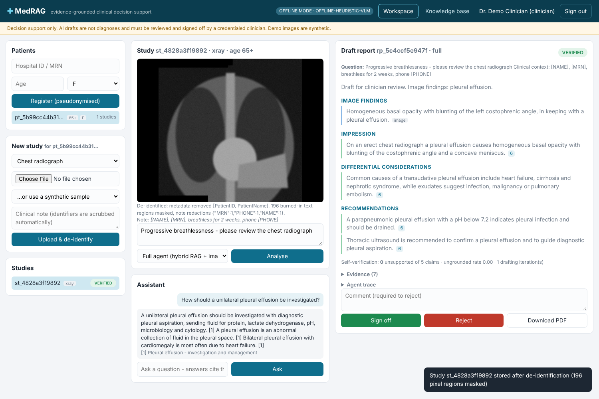

# MedRAG — Agentic Multimodal RAG for Evidence-Grounded Clinical Decision Support

MS thesis implementation of *“A Medical Agentic Multimodal Retrieval-Augmented Generation System for Evidence
Grounded Clinical Decision Support”* (Govt. College University, Faisalabad).

MedRAG drafts **cited, self-verified diagnostic reports** from a clinical image (chest radiograph, retinal fundus
photograph or histopathology slide) plus a clinical question, for a clinician to review. It is **decision
support**: the agent can at best produce a *verified draft*; only a credentialed human clinician can sign a
report off, and that rule is enforced in code beneath the API.



## What is implemented

| Synopsis component | Where |
|---|---|
| Hybrid retrieval: dense (BGE-M3) + sparse (BM25) → reciprocal rank fusion → cross-encoder re-rank, metadata filters (modality, age band) | `medrag/retrieval/` |
| Sentence-boundary chunking (~500 tokens, overlap), synchronised dense + sparse indexes | `retrieval/chunking.py`, `retrieval/pipeline.py` |
| Vision-language model (Qwen2.5-VL via vLLM) and similar-case retrieval (BiomedCLIP) | `medrag/imaging/` |
| Agent as an explicit state machine: route → retrieve → inspect image → draft → verify, with a **bounded** self-correction loop (re-retrieve on unsupported claims) | `medrag/agent/` |
| De-identification at ingestion: metadata stripping, **burned-in pixel text masking**, HMAC patient pseudonyms, age bands, free-text PHI scrubbing, vector-payload allowlist | `medrag/deid/`, `retrieval/vector_store.py`, `service.py` |
| Enforced human sign-off state machine (agent/system/admin/viewer can never sign off) | `medrag/reports/lifecycle.py` |
| PDF reports with “DRAFT – NOT FOR CLINICAL USE” watermark until signed | `medrag/reports/document.py` |
| Relational DB + **append-only, hash-chained audit log**; object store; vector store (memory or Qdrant) | `medrag/storage/` |
| Secured REST API with role-based access control (clinician / admin / viewer) | `medrag/api/` |
| Clinical workspace web app (patients, studies, image viewer, assistant chat, draft report, sign-off, KB search, audit) | `medrag/web/` |
| Evaluation: Recall@K, MRR, latency mean/P95, ungrounded-claim (hallucination) rate, report similarity, ablations (no-retrieval, single-pass, text-only), release gates | `medrag/eval/` |
| Offline mode (deterministic stand-ins, no GPU) and real mode (GPU-served models) | `medrag/config.py` |
| 117 automated tests, ruff-clean, GitHub Actions CI | `tests/`, `.github/workflows/ci.yml` |

## Quick start (offline mode — any laptop, no GPU)

Requires Python ≥ 3.10.

```bash
make install
```

```bash
make run
```

Open <http://localhost:8000> and sign in as `clinician / clinician123`. Then:

1. Register a patient (the hospital ID is stored only as an irreversible HMAC pseudonym).
2. Under **New study**, pick a synthetic sample (e.g. *xray: effusion*). Each sample has fake identifiers burned into
   its pixels and metadata. Click **Upload & de-identify** and watch them disappear.
3. Enter a clinical question and click **Analyse**. You get a structured draft with numbered citations, the
   self-verification result, retrieved evidence, similar prior cases and the full agent trace.
4. **Sign off** or **Reject** (a reason is required), then **Download PDF**.
5. Sign in as `admin / admin123` to view and verify the audit log hash chain and add guideline documents.
   `viewer / viewer123` is read-only.

Other commands:

```bash
make test        # 117 tests
```

```bash
make eval        # retrieval + clinical evaluation with ablations -> eval_results/results.md
```

```bash
make demo        # end-to-end case in the terminal, writes a signed PDF to var/
```

```bash
make samples     # write the synthetic sample images to data/samples/
```

Without `make`: `python -m venv .venv && . .venv/bin/activate && pip install -e ".[dev]" && medrag serve`.

## Real mode (GPU)

```bash
cp .env.example .env    # set MEDRAG_MODE=real and uncomment the real-mode block
```

```bash
MEDRAG_EXTRAS=real docker compose --profile gpu up --build
```

This starts vLLM serving **Qwen2.5-VL-7B-Instruct** (an OpenAI-compatible endpoint on your own hardware, so
patient data never leaves the host), Qdrant, and MedRAG with BGE-M3 embeddings, the bge-reranker-v2-m3
cross-encoder, the BiomedCLIP image encoder and Tesseract OCR. Heavy ML libraries are imported lazily, so
the same code base still imports and tests on a CPU-only machine.

## Architecture

```
 Clinical workspace (web)  ──HTTPS/JSON──►  FastAPI + RBAC  ──►  MedRAGService
                                                                     │
          ┌───────────────┬──────────────────┬───────────────────────┼──────────────────────┐
          ▼               ▼                  ▼                       ▼                      ▼
   De-identification   SQLite (records +   Object store        Retrieval pipeline       Agent (state machine)
   (metadata, pixels,  append-only audit)  (de-identified      dense ⊕ sparse → RRF     route → retrieve → inspect
    text, pseudonyms)                       images)            → cross-encoder          → draft → verify ↺ (bounded)
                                                               (vector store + BM25)    VLM · generator · verifier
                                                                                        ──► verified draft only
   Report lifecycle: draft → verified | needs_review ──(human clinician only)──► signed_off | rejected
```

See [docs/ARCHITECTURE.md](docs/ARCHITECTURE.md), [docs/EVALUATION.md](docs/EVALUATION.md) and
[docs/PLAN.md](docs/PLAN.md) (research questions and objectives mapped to code and remaining work).

## Important notes

* **Not a medical device.** For research and education only. No real patient data is included.
* The knowledge base in `data/knowledge_base/` is a small set of **educational summaries written for development**.
  Replace them with licensed sources (NICE, WHO, PubMed Central Open Access) before any serious evaluation.
* Images produced by `medrag samples` and the workspace’s sample picker are **synthetic cartoons**. The offline
  “VLM” is a deterministic heuristic tuned to them. It exists so that the full control flow can be exercised and
  tested without a GPU. It is not a diagnostic model.
* Offline evaluation figures validate the harness only. They are **not clinical results** (see docs/EVALUATION.md).
* Change `MEDRAG_SECRET_KEY` and `MEDRAG_PATIENT_SALT`, and set `MEDRAG_SEED_DEMO=0`, outside of demos.
